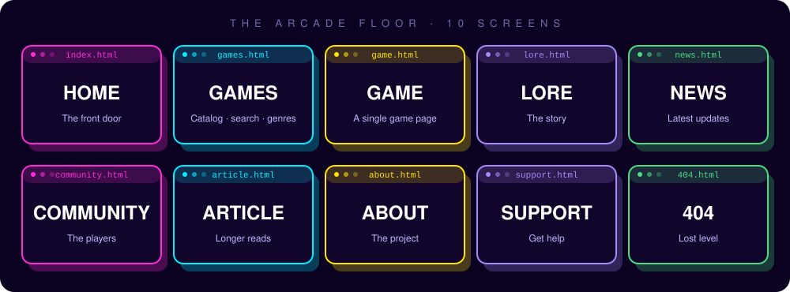
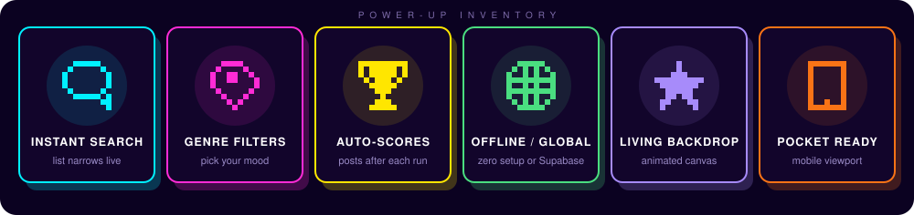
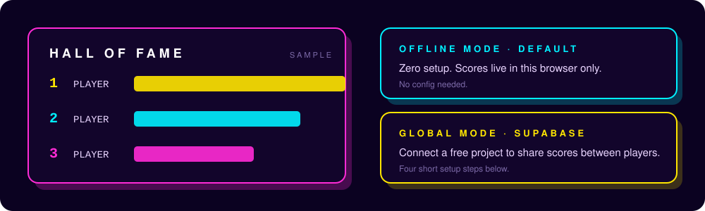
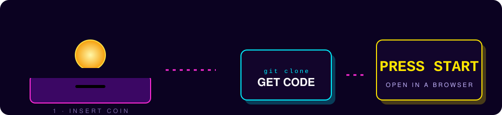
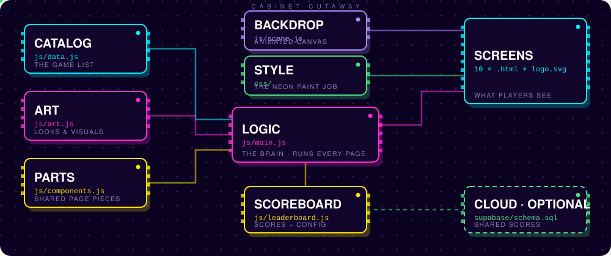

<!-- CIPHER NEXUS | NEON ARCADE README -->

<div align="center">



<a href="https://github.com/SyedRaqi/Cipher-Nexus">
  
</a>

<br/>

<a href="#-insert-coin"></a>
&nbsp;
<a href="#-the-arcade-floor"></a>
&nbsp;
<a href="#-hall-of-fame"></a>

<br/><br/>


</div>



## 🕹️ Press Start

> **Cipher Nexus is a simple game for youngsters.**

It's a little arcade that lives in your browser: a game catalog you can search and filter by genre, individual game pages, lore, news, a community corner, and a leaderboard where your scores post automatically once you've picked a name. No installs, no build tools, just open it and play.

<div align="center">

</div>

## 🏟️ The Arcade Floor

<div align="center">

</div>

<br/>

<details>
<summary><b>🗺️ Floor map: what lives where</b></summary>

<br/>

| SCREEN | FILE | WHAT IT IS |
|---|---|---|
| 🏠 Home | `index.html` | The front door |
| 🎮 Games | `games.html` | The catalog, with live search and genre filters |
| 🕹️ Game | `game.html` | A single game's page |
| 📜 Lore | `lore.html` | The story behind the Nexus |
| 📰 News | `news.html` | Latest updates |
| 💬 Community | `community.html` | Where players hang out |
| 📖 Article | `article.html` | Longer reads |
| ℹ️ About | `about.html` | About the project |
| 🛟 Support | `support.html` | Help |
| 🚧 Lost level | `404.html` | Friendly dead end |

</details>

## ⚡ Power-Ups

<div align="center">

</div>

<br/>

<table>
<tr>
<td width="33%" valign="top">

### 🔎 Instant Search
Type in the games catalog and the list narrows as you go, no page reloads.

</td>
<td width="33%" valign="top">

### 🏷️ Genre Filters
Jump straight to the kind of game you're in the mood for.

</td>
<td width="33%" valign="top">

### 🏆 Auto-Posting Scores
Set a name (2+ characters) and your score posts itself after every run.

</td>
</tr>
<tr>
<td width="33%" valign="top">

### 🌐 Offline or Global
Works with zero setup, or plug in Supabase to share scores with everyone.

</td>
<td width="33%" valign="top">

### 🌌 Living Backdrop
An animated canvas scene sits behind the pages so the arcade never feels static.

</td>
<td width="33%" valign="top">

### 📱 Pocket Ready
The pages are set up with a mobile viewport and a themed browser bar color.

</td>
</tr>
</table>

## 🎯 How a Run Goes

<div align="center">

</div>


## 🏆 Hall of Fame

<div align="center">

</div>

The page includes a leaderboard. Scores post automatically after each run once the player has set a name (at least 2 characters).

**🔌 Offline mode (default):** with no configuration, scores are saved in this browser only.

**🌍 Global mode:** to share scores between players:

1. Create a free project at [supabase.com](https://supabase.com).
2. In the SQL Editor, run `supabase/schema.sql`.
3. In Project Settings > API, copy the **Project URL** and the **anon (public) key**.
4. Paste them into `CONFIG` in `js/leaderboard.js`.

> 🛡️ **Fair-play notes:** the anon key is designed to be public. Row level security allows reading and adding scores only, and the database rejects scores above what each game can produce and limits each name to one submission per 10 seconds. Because the games run in the browser, a determined cheater can still post a believable score.

## 🪙 Insert Coin

<div align="center">

</div>

<br/>

**Step 1 · Grab the code**

```bash
git clone https://github.com/SyedRaqi/Cipher-Nexus.git
cd Cipher-Nexus
```

**Step 2 · Open the arcade**

It's plain HTML, CSS, and JavaScript, so there's nothing to install. Open `index.html` in your browser. For the most reliable results, serve the folder with any static server, for example:

```bash
python -m http.server 8000
```

then visit http://localhost:8000.


## 🔧 Inside the Cabinet

Pop the back panel off and this is what's humming inside. The glowing pulses show how the pieces feed each other.

<div align="center">

</div>

<br/>

| 🔩 CHIP | 📍 WHERE | ⚡ JOB |
|---|---|---|
| 📋 **Catalog** | `js/data.js` | Holds the game list the catalog page draws from |
| 🎨 **Art** | `js/art.js` | Visuals for the arcade |
| 🧩 **Parts** | `js/components.js` | Shared page pieces like the header and footer |
| 🧠 **Logic** | `js/main.js` | The brain that runs on every page |
| 🌌 **Backdrop** | `js/scene.js` | The animated canvas scene behind the pages |
| 🖌️ **Style** | `css/` | The neon paint job |
| 🏆 **Scoreboard** | `js/leaderboard.js` | Leaderboard logic, plus the `CONFIG` for Supabase |
| ☁️ **Cloud (optional)** | `supabase/schema.sql` | Database setup for global scores |
| 📺 **Screens** | `*.html`, `logo.svg` | The ten pages and the Nexus mark |

<details>
<summary><b>🗂️ Show the raw file tree</b></summary>

```text
Cipher-Nexus/
├── index.html · games.html · game.html     # the main screens
├── lore.html · news.html · community.html  # world and people
├── article.html · about.html · support.html
├── 404.html                                # lost-level page
├── logo.svg                                # the Nexus mark
├── css/                                    # styles
├── js/
│   ├── data.js · art.js · components.js
│   ├── main.js · scene.js
│   └── leaderboard.js
└── supabase/
    └── schema.sql
```

</details>

## 📜 License

Released under the [Unlicense](LICENSE). Take it, remix it, make it your own.

<div align="center">


**Cipher Nexus** · Built by [Syed Raqi](https://github.com/SyedRaqi) · [⭐ Star it if you had fun](https://github.com/SyedRaqi/Cipher-Nexus)

<sub>Insert coin. Press start. Beat your own high score.</sub>

</div>
